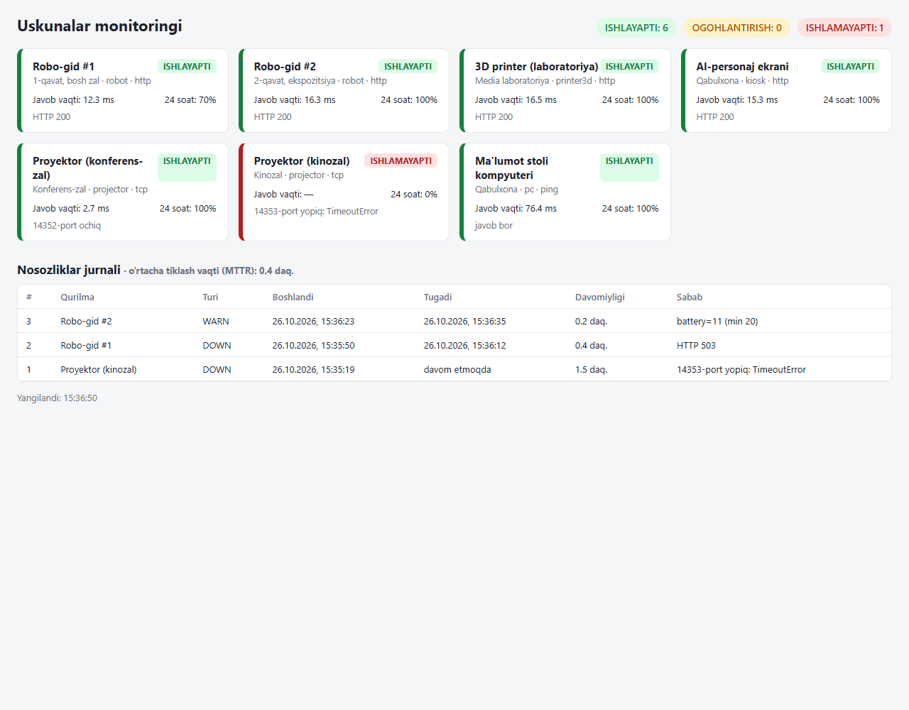

# equipment-monitor — muzey va ko'rgazma uskunalari monitoringi

Robo-gidlar, 3D printerlar, proyektorlar, AI-ekranlar (kiosklar) va kompyuterlarning holatini
uzluksiz tekshiradi. Qurilma ishlamay qolsa yoki ko'rsatkichi xavfli bo'lsa (batareya kam,
harorat yuqori, printer xatoda), **texnik xodimga Telegram orqali darhol xabar yuboradi**.
Har bir nosozlik jurnalga yoziladi va o'rtacha tiklash vaqti (MTTR) hisoblanadi.



## Nima uchun kerak

Texnik xodimning asosiy vazifasi: uskunalarning **uzluksiz ishlashini ta'minlash**.
Muammoni tashrif buyuruvchi shikoyat qilganda emas, birinchi daqiqadayoq bilish kerak.
Masalan: robo-gid zaryadga qaytmay batareyasi 15% ga tushdi, kinozal proyektori tarmoqdan uzildi,
3D printer `Error` holatiga o'tdi.

## Imkoniyatlar

| | |
|---|---|
| **3 xil tekshiruv** | `ping` (kompyuter, router), `tcp` port (proyektor PJLink 4352, kamera RTSP 554, SSH 22), `http` health endpoint (robot, 3D printer, kiosk) |
| **Ko'rsatkichlar nazorati** | JSON javobdagi qiymatlar: `min = { battery = 20 }`, `max = { hotend_temp = 260 }`, `expect = { state = ["Printing"] }` |
| **Soxta ogohlantirishdan himoya** | Ketma-ket 2 ta xato bo'lsagina DOWN (sozlanadi). Bitta tasodifiy uzilish signal bermaydi |
| **Holat mashinasi** | OK → WARN → DOWN → TIKLANDI. Har bir o'tishda faqat bitta xabar (spam yo'q) |
| **Nosozliklar jurnali** | SQLite: qachon boshlandi, qachon tugadi, davomiyligi, sababi. 24 soatlik uptime %, MTTR |
| **Telegram** | Bot API orqali. Token faylda emas, muhit o'zgaruvchisida saqlanadi |
| **Dashboard** | Har 5 soniyada yangilanadi, telefonda ham ishlaydi, qorong'i mavzu |
| **Parallel tekshiruv** | `ThreadPoolExecutor`: 100 ta qurilma ham bir necha soniyada tekshiriladi |
| **Simulyator** | Real qurilma bo'lmasa ham sinash mumkin: robot batareyasi kamayadi, printer xatoga tushadi, robot vaqti-vaqti bilan "o'chadi" |

## Ishga tushirish

```bat
python -m venv .venv
.venv\Scripts\activate
pip install -r requirements.txt

:: 1-terminal: soxta uskunalar
python -m simulator

:: 2-terminal: monitoring + dashboard -> http://localhost:8080
python -m monitor serve

:: boshqa buyruqlar
python -m monitor once      :: bir marta tekshirib, jadval chiqarish
python -m monitor report    :: uptime, nosozliklar soni, MTTR
pytest                      :: 9 ta test
```

Robotni qo'lda "buzib" ko'rish (35 soniyaga):
```bat
curl -X POST "http://127.0.0.1:9100/sim/robot-1/fail?seconds=35"
```

### Telegram xabarlarini yoqish
1. Telegram'da **@BotFather** → `/newbot` → token olinadi.
2. Botga biror xabar yozing, so'ng `https://api.telegram.org/bot<TOKEN>/getUpdates` dan `chat.id` ni oling.
3. Muhit o'zgaruvchilari:
   ```bat
   set TELEGRAM_BOT_TOKEN=123456:ABC...
   set TELEGRAM_CHAT_ID=987654321
   python -m monitor serve
   ```

Xabar namunasi:
```
🔴 ISHLAMAYAPTI
Robo-gid #1
Joyi: 1-qavat, bosh zal
HTTP 503
```

## Real ob'ektga moslash

`devices.toml` ga har bir qurilma bir necha qatorda qo'shiladi:
```toml
[[device]]
id = "projector-hall"
name = "Proyektor (katta zal)"
type = "projector"
location = "Katta zal"
check = "tcp"
host = "192.168.10.45"   # qurilmaning lokal IP manzili
port = 4352              # PJLink
```
Qurilmalarga doimiy IP berish (DHCP reservation) tavsiya etiladi, aks holda manzil o'zgarib qoladi.

## Tuzilma

```
monitor/config.py    TOML'dan qurilmalar ro'yxati + validatsiya
monitor/checks.py    ping / tcp / http tekshiruvlari, chegaralarni baholash
monitor/engine.py    holat mashinasi, nosozlik ochish/yopish, xabar yuborish
monitor/storage.py   SQLite: tarix, holat, nosozliklar, uptime, MTTR
monitor/notify.py    Telegram / konsol
monitor/web.py       FastAPI: /api/status, /api/incidents, dashboard
simulator/           soxta robot, 3D printer, kiosk, proyektor
tests/               pytest: holat mashinasi, chegaralar, tcp/ping/http, Telegram
```

> Demo'dagi barcha qurilmalar simulyatsiya qilingan. Real robo-gid yoki 3D printer API'si (masalan, OctoPrint `/api/printer`)
> boshqa maydon nomlarini qaytarishi mumkin, ular `devices.toml` dagi `min/max/expect` orqali moslashtiriladi.
